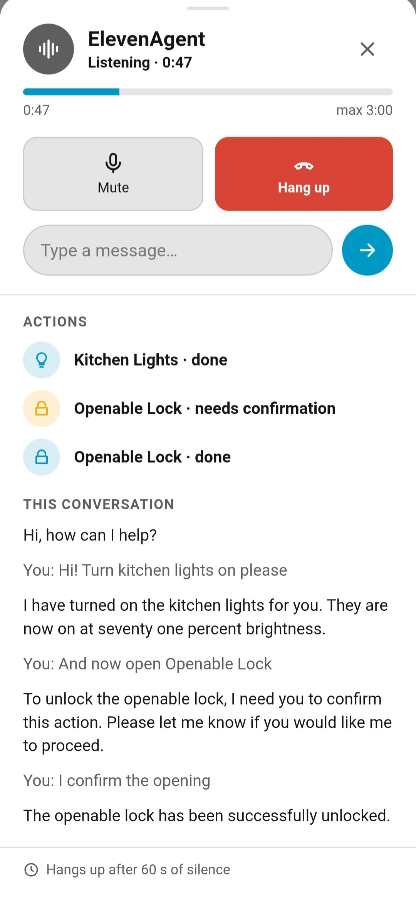
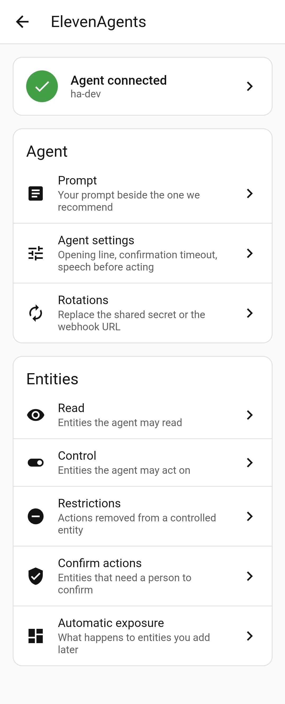
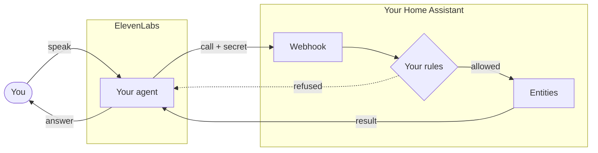

# ElevenAgents for Home Assistant

[](https://hacs.xyz/docs/faq/custom_repositories)
[](https://github.com/javierborrallo/ha-elevenagents/releases/latest)
[](https://github.com/javierborrallo/ha-elevenagents/actions/workflows/test.yml)
[](https://github.com/javierborrallo/ha-elevenagents/actions/workflows/validate.yml)

Let [ElevenAgents](https://elevenlabs.io/docs/agents-platform/overview) interact with your Home
Assistant, through tools this integration writes and keeps up to date for you.

> [!WARNING]
> **Beta.** A new version may break your configuration.

<p align="center">
  
  
</p>

## What this is

Not ElevenLabs text-to-speech: Home Assistant already ships
[that integration](https://www.home-assistant.io/integrations/elevenlabs/).

This integration lets your ElevenAgents agent talk with you and act on your house. The agent does the
talking and the reasoning. Home Assistant holds the state and runs every action, after checking it
against the rules you set.



You never write a tool schema. Select the entities the agent may read and control, and the
integration writes and maintains the tools from them.

The panel and the dashboard card are in English and Spanish.

## Design principles

- **Your key, nothing else.** You bring your ElevenLabs API key. No server run by anyone else
  stands in between.
- **No Home Assistant token leaves the house.** ElevenLabs never reaches Home Assistant's REST or
  WebSocket API.
- **Deny by default.** The agent sees no entity until you select it.
- **No open-ended actions.** The agent performs only the actions you allowed, on the entities you
  selected.

## Why not Home Assistant's MCP server?

Home Assistant ships an MCP server, and ElevenAgents accepts MCP servers as tools. Joining them would
mean giving ElevenLabs a Home Assistant access token. That token works on Home Assistant's whole API
with its user's permissions, not only on what the MCP server exposes.

This integration gives ElevenLabs a secret that opens one webhook, and every call passes your rules.
A leaked secret reaches what the agent reaches, nothing more. ElevenLabs calls the webhook itself,
so it works however the conversation started: from the dashboard card, a phone call or the
ElevenAgents widget.

This integration may later offer its own MCP endpoint, behind the same secret and rules. This
version does not.

## Requirements

- Home Assistant 2026.9.0 or newer.
- An agent, and an ElevenLabs API key with **write** access to ElevenAgents. A key limited to
  text-to-speech cannot write the tools.
- A webhook URL that ElevenLabs can reach: Nabu Casa (not tested yet), a Cloudflare tunnel, ngrok
  or a reverse proxy. The rest of Home Assistant can stay private; see
  [A private Home Assistant](docs/private-home-assistant.md).

## Installation

[](https://my.home-assistant.io/redirect/hacs_repository/?owner=javierborrallo&repository=ha-elevenagents&category=integration)

Or add it by hand: in HACS, open **Custom repositories**, add
`https://github.com/javierborrallo/ha-elevenagents` as an **Integration**, and download it.
Restart Home Assistant.

Without HACS, copy `custom_components/elevenagents` from the
[latest release](https://github.com/javierborrallo/ha-elevenagents/releases/latest) into your
`custom_components` folder, and restart.

## Setup

[](https://my.home-assistant.io/redirect/config_flow_start/?domain=elevenagents)

1. **Set your external URL** under Settings > System > Network. The tools call that URL,
   unless you enter a different webhook URL in step 2.
2. **Add the integration.** It asks for your API key, the webhook URL and your agent.
3. **Open the panel.** The setup's closing message links to it. A first-run wizard walks you
   through seven steps: agent settings, prompt, the entities to read, the entities to control, actions to take
   back, entities that need a confirmation, and what happens to entities you add later.
4. **Paste the prompt block.** The panel's *Prompt* step shows it beside your own prompt, with a
   button to copy it. Paste it into your prompt and save. The agent needs it to read the tools'
   answers. The text is also in
   [docs/prompt-block.md](docs/prompt-block.md).
5. **Check it.** Select the agent's status at the top of the panel to run the connection check. It tests the key, the agent, the
   tools and the webhook, and spends no credits.

Then talk to the agent from the ElevenAgents widget, a phone call, or the dashboard card
`custom:elevenagents-card`. The browser opens the microphone only on an `https://` page or on
localhost, so the card cannot talk on a dashboard opened at `http://<lan-ip>:8123`.

## Choosing a model

The agent's model is set in ElevenLabs. This integration was built and tested with
`gemini-3.1-flash-lite`, with reasoning set to minimal and temperature 0.

With a cheaper model, the agent reported actions it never sent: it said the light was on, and the
light stayed off. If that happens, change the model.

Every action the agent sends fires `elevenagents_action` and shows in the logbook as
"ElevenAgents". If the agent says it acted and the logbook shows nothing, the action never ran.

## Security

Read this before you hand the agent a lock, an alarm or a garage door.

**An open agent is a door into your house.** ElevenLabs creates agents open: unless you turn on
signed URLs or a hostname allowlist for the agent in ElevenLabs, anyone who knows its ID can talk to it,
and the ID is no secret. That person breaks nothing: the agent does for them what it does for you.
The integration raises an issue under Settings > System > Repairs while your agent is open. The
issue offers to turn on signed URLs for you.

**Sensitive entities can ask first.** Tick **Requires confirmation** on an entity under **Confirm
actions**. By default, the agent must then ask you before it acts on that entity, and an automatic
event cannot act on it at all. Home Assistant checks that you answered; the agent's word is not
enough. Marking an entity does not mark a script or scene that moves it. See
[docs/permissions.md](docs/permissions.md).

**An upgrade can widen what you allowed.** When a Home Assistant update adds an action to an entity
the agent controls, the agent gains that action. It shows ticked under **Restrictions**; untick it
there to take it back.

**Automatic exposure adds entities without review.** It has two switches, one for reading and one
for control, both off by default. With control on, a new entity in a watched area becomes
controllable as soon as it appears. That includes an entity a firmware update adds to a device you
already use.

**A timeout means unknown.** When an action does not finish in time, the agent hears `unconfirmed`,
and the action may still have run. The prompt block tells the agent to check the state instead of
trying again.

Entities from YAML, templates or groups without a `unique_id` keep their permissions under
their old name when you rename them; see
[docs/permissions.md](docs/permissions.md).

## Costs

Every conversation spends ElevenLabs credits, whether it starts from the card, a phone call or the
widget. So does every automatic event, which an automation sends with `elevenagents.send_event`. Anyone who can open
a dashboard with the card can start a conversation, so think before you put it on a shared one. The
panel limits how often automatic events go out.

## Support

Open a [GitHub issue](https://github.com/javierborrallo/ha-elevenagents/issues). Attach the diagnostics,
from **Download diagnostics** in the integration's menu. They hide your API key, the agent ID, the webhook
secret, the webhook URL and the names of your entities and areas, and hold no entity state.

For a debug log, use **Enable debug logging** on the integration page. To log from startup, or to
see every request to ElevenLabs, add this to `configuration.yaml`:

```yaml
logger:
  logs:
    custom_components.elevenagents: debug
    httpx: info
```

The `httpx` line logs every request Home Assistant makes, from every integration, with its URL.
Requests to ElevenLabs carry your agent ID in the URL; remove it before you share the log.

Removing the integration detaches its two tools from your agent and deletes them. If ElevenLabs
cannot be reached at that moment, the tools stay; delete `ha_get_state` and `ha_perform_action` by
hand from the agent's tools in ElevenLabs.

## Documentation

- [The prompt block](docs/prompt-block.md)
- [A private Home Assistant](docs/private-home-assistant.md): the webhook behind a reverse proxy
- [Permissions](docs/permissions.md): confirmation, and entities without a `unique_id`
- [Events](docs/events.md): `send_event` and the `elevenagents_action` event

To contribute, read [CONTRIBUTING.md](CONTRIBUTING.md).

## Credits

Scaffolded from [ludeeus/integration_blueprint](https://github.com/ludeeus/integration_blueprint).
The card ships `@elevenlabs/client` under its MIT licence.

## License

MIT. See [LICENSE](LICENSE).
